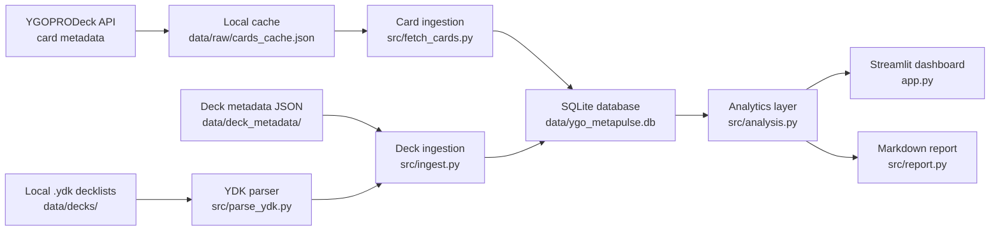

<p align="center">
  
</p>

<h1 align="center">YGO MetaPulse</h1>

<p align="center">
  <strong>Local decklist intelligence for Yu-Gi-Oh! TCG tournament analysis.</strong>
</p>

<p align="center">
  
  
  
  
  
  
</p>

## Overview

Yu-Gi-Oh! decklists are often shared as plain `.ydk` files: useful for players, but awkward for analysis. They contain repeated numeric card IDs split across main, extra and side deck sections, while the useful context about each card lives elsewhere.

YGO MetaPulse turns those files into a local analytics pipeline. It parses `.ydk` decklists, joins them to cached YGOPRODeck card metadata, stores the normalized data in SQLite, and exposes metagame views through a Streamlit dashboard.

The project deliberately avoids web scraping. Decklists come from local imports in `data/decks/` with matching metadata JSON files in `data/deck_metadata/`. The YGOPRODeck API is used only for card metadata, and the response is cached locally in `data/raw/cards_cache.json`.

The repository includes illustrative sample decklists so the application can be run immediately after setup. These samples use real card IDs resolved from YGOPRODeck metadata, but they are not claimed to be verified tournament decklists.

With the included sample inputs, the pipeline currently loads:

- `14,369` cached card metadata records from YGOPRODeck.
- `16` illustrative decklists across `12` archetype labels.
- `311` unique cards appearing in the loaded decklists.

## Current Screenshots

Dashboard overview:


Card usage view:


Generated meta report:


## Key Capabilities

- Fetches Yu-Gi-Oh! card metadata from the YGOPRODeck card database endpoint.
- Caches API responses locally to avoid repeatedly hitting the public API.
- Parses `.ydk` files into main, extra and side deck card quantities.
- Requires matching deck metadata JSON for event name, event date, placement, player, archetype, format and source notes.
- Stores cards, decks and deck-card relationships in a normalized SQLite schema.
- Re-runs ingestion idempotently by updating deck metadata and replacing deck-card mappings for each deck slug.
- Computes archetype breakdowns, most-played cards, inclusion rates, side-deck trends, deck price estimates, banlist-sensitive cards and rule-based engine detection.
- Generates a deterministic markdown meta report from the analytics layer without requiring an LLM call.
- Provides automated tests for parsing, database idempotency, ingestion behaviour, sample data assumptions and analytics outputs.

## Architecture And Data Flow



The ingestion flow is:

1. Load card metadata from `data/raw/cards_cache.json`, or fetch it from YGOPRODeck if the cache is missing or refresh is requested.
2. Upsert card metadata into the `cards` table, including selected fields such as name, type, frame type, archetype, TCG banlist status and Cardmarket price.
3. Discover local `.ydk` files in `data/decks/`.
4. Prefer non-sample deck files over bundled `sample_*` files when imported lists are present.
5. Parse main, extra and side deck sections into card quantities.
6. Join each deck file to metadata JSON with the same stem.
7. Insert or update deck rows and replace their deck-card mappings.
8. Query SQLite into pandas dataframes for dashboard and report generation.

## Technical Decisions

- **No scraping in the current version:** decklists are intentionally imported from local files so the pipeline stays reproducible and source handling is explicit.
- **SQLite for local analytics:** the database is simple to create, inspect and reset. `data/ygo_metapulse.db` is generated locally and ignored by Git.
- **Cached card metadata:** the raw YGOPRODeck payload is committed as a local cache so the sample workflow can run even when the API is unavailable.
- **Normalized schema:** card metadata, deck metadata and deck-card quantities are separated into `cards`, `decks` and `deck_cards`.
- **Idempotent ingestion:** re-running `python -m src.ingest` updates existing deck slugs instead of duplicating rows.
- **Deterministic reporting:** `src/report.py` generates a readable markdown summary from pandas outputs without depending on external AI services.
- **Single dependency source:** runtime and development dependencies are declared in `pyproject.toml`; `requirements.txt` installs the project with its dev extras for the standard setup workflow.

## Setup

Clone the repository:

```bash
git clone https://github.com/GerardLab77/ygo-metapulse.git
cd ygo-metapulse
```

Create and activate a virtual environment:

```bash
python -m venv .venv
```

Windows PowerShell:

```powershell
.\.venv\Scripts\Activate.ps1
```

macOS / Linux:

```bash
source .venv/bin/activate
```

Install dependencies, run ingestion and start the dashboard:

```bash
pip install -r requirements.txt
python -m src.ingest
streamlit run app.py
```

On Windows, if `python` points to the Microsoft Store placeholder, use the included runner:

```powershell
.\run_project.ps1
```

The dashboard opens at `http://localhost:8501/` by default.

## Testing

Run the test suite:

```bash
pytest
```

The GitHub Actions workflow in `.github/workflows/ci.yml` runs the same test command on pushes and pull requests for Python 3.11 and 3.12.

## Repository Layout

```text
ygo-metapulse/
  app.py
  pyproject.toml
  requirements.txt
  run_project.ps1
  .github/workflows/ci.yml
  data/
    raw/cards_cache.json
    decks/
    deck_metadata/
  docs/
    assets/ygo-metapulse-logo.png
    screenshots/
  src/
    analysis.py
    config.py
    db.py
    fetch_cards.py
    ingest.py
    parse_ydk.py
    report.py
    sample_data.py
  tests/
```

## Limitations And Future Work

- Included sample decklists are illustrative, not verified tournament results.
- Trend velocity is intentionally simple and becomes more meaningful with a larger dated dataset.
- Price estimates depend on Cardmarket values exposed through YGOPRODeck metadata.
- The current storage layer is SQLite; PostgreSQL would be a better fit for multi-user or deployed workflows.
- Future work could add richer import validation, historical trend tracking, automated tournament-source ingestion where permitted, matchup data and online deployment.
