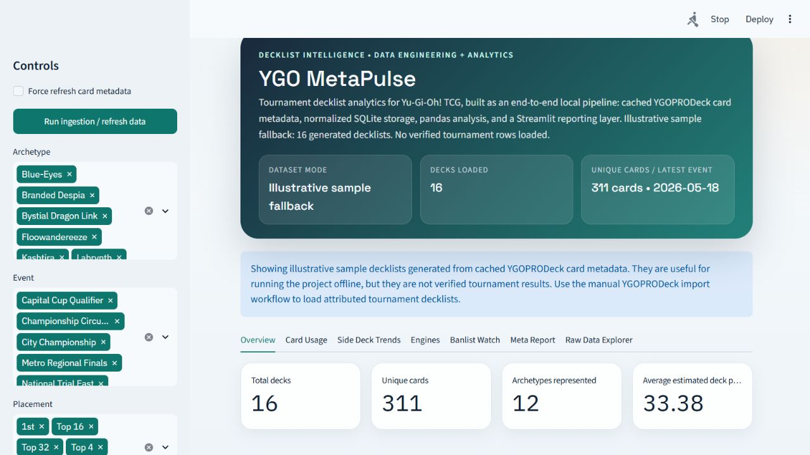
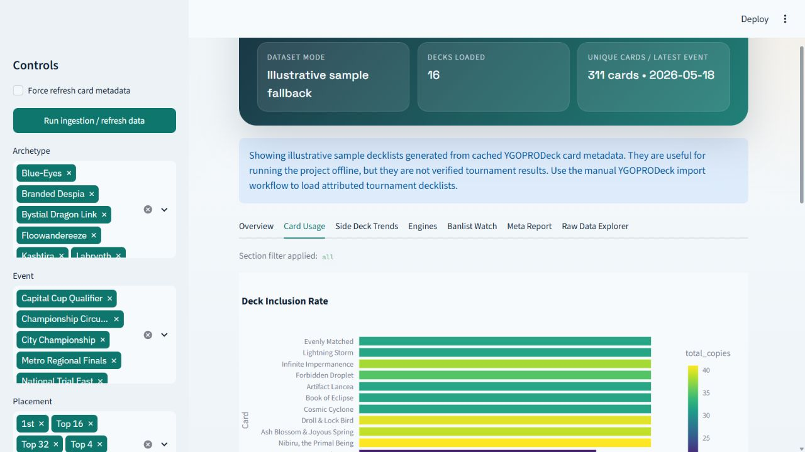
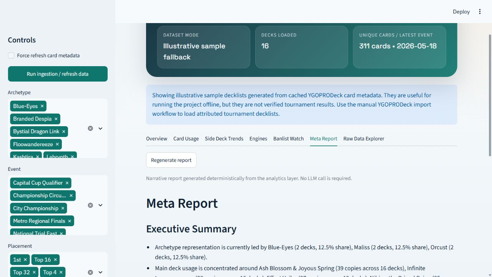
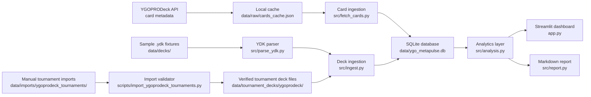

<p align="center">
  
</p>

<h1 align="center">YGO MetaPulse</h1>

<p align="center">
  <strong>A local Yu-Gi-Oh! TCG decklist analytics pipeline built with Python, SQLite, pandas and Streamlit.</strong>
</p>

<p align="center">
  
  
  
  
  
  
</p>

## Overview

Yu-Gi-Oh! decklists are commonly shared as `.ydk` files. They are easy to load into simulators, but they are not immediately useful for analysis: each card appears as a numeric ID, repeated copies are separate lines, and tournament context usually lives outside the deck file.

YGO MetaPulse turns those local deck files into a small analytics warehouse. It parses main, extra and side deck sections, joins card IDs to cached YGOPRODeck card metadata, stores the normalized result in SQLite, and exposes metagame views through a Streamlit dashboard.

The repository includes illustrative sample decklists so the app works immediately after setup. Those samples use real card IDs from the cached card database, but they are not verified tournament results. Verified tournament decklists are kept in a separate import path and are loaded by default once present.

YGOPRODeck is used as the source for card metadata via its public API. Tournament decklists should be imported from manually downloaded `.ydk` files plus an attribution manifest; the project does not scrape deck pages or bypass access controls.

## Current Screenshot



Additional screenshots:





## Key Capabilities

- Fetches card metadata from the YGOPRODeck card database endpoint and caches it in `data/raw/cards_cache.json`.
- Parses `.ydk` files into main, extra and side deck card quantities.
- Stores cards, deck metadata and deck-card quantities in a normalized SQLite database.
- Rebuilds deck data idempotently so repeated ingestion does not duplicate deck rows or card mappings.
- Separates generated sample fixtures from verified tournament imports.
- Validates manually imported tournament decklists for deck size, malformed YDK files, duplicate sources and unknown card IDs.
- Produces machine-readable import reports for accepted, incomplete and rejected tournament rows.
- Calculates archetype share, card usage, inclusion rates, staple usage, side-deck trends, estimated deck prices, banlist-sensitive cards and simple engine detections.
- Generates a deterministic markdown meta report without requiring an LLM or external service.
- Runs automated tests through pytest and GitHub Actions.

## Architecture And Data Flow



The pipeline runs in these stages:

1. Load card metadata from the local cache, or fetch it from YGOPRODeck if the cache is missing or a refresh is requested.
2. Upsert card records into SQLite with selected metadata such as name, type, frame type, archetype, TCG banlist status and Cardmarket price.
3. Choose the deck dataset. `auto` mode prefers verified tournament imports, then non-sample local imports, then generated sample fixtures.
4. Parse `.ydk` deck sections into card quantities.
5. Read matching metadata JSON for event, player, placement, archetype, source and provenance fields.
6. Insert or update deck rows and replace deck-card mappings.
7. Query SQLite into pandas dataframes for dashboard analytics and report generation.

## Technical Decisions

- **Local-first ingestion:** SQLite, local files and a cached card payload make the project reproducible without hosted infrastructure.
- **No deck-page scraping:** YGOPRODeck decklists are imported from local files with explicit attribution rather than scraped from site pages.
- **Clear dataset modes:** sample fixtures are useful for onboarding, but tournament analytics only use imported tournament rows when they exist.
- **Idempotent writes:** each deck slug is upserted and its card mappings are replaced, which keeps repeated ingestion safe.
- **Dependency clarity:** dependencies live in `pyproject.toml`; `requirements.txt` installs the project with development extras for the standard setup path.
- **Deterministic reporting:** the report is generated from pandas outputs, so it can run in CI or offline without secrets.

## Setup

Clone the repository:

```bash
git clone https://github.com/GerardLab77/ygo-metapulse.git
cd ygo-metapulse
```

Create and activate a virtual environment:

```bash
python -m venv .venv
```

Windows PowerShell:

```powershell
.\.venv\Scripts\Activate.ps1
```

macOS / Linux:

```bash
source .venv/bin/activate
```

Install dependencies, run ingestion and start the dashboard:

```bash
pip install -r requirements.txt
python -m src.ingest
streamlit run app.py
```

On Windows, if `python` points to the Microsoft Store placeholder, use the included runner:

```powershell
.\run_project.ps1
```

The dashboard opens at `http://localhost:8501/` by default.

## Importing Tournament Decklists

The curated source category is [YGOPRODeck Tournament Meta Decks (TCG)](https://ygoprodeck.com/category/format/tournament%20meta%20decks). YGO MetaPulse is not affiliated with or endorsed by YGOPRODeck, Konami or 4K Media.

To import verified tournament decklists:

1. Browse the YGOPRODeck Tournament Meta Decks (TCG) category manually.
2. Download decklists using the site-provided YDK download action where available.
3. Place the downloaded `.ydk` files in `data/imports/ygoprodeck_tournaments/manual_ydk/`.
4. Copy `data/imports/ygoprodeck_tournaments/import_manifest_template.csv` to `data/imports/ygoprodeck_tournaments/import_manifest.csv`.
5. Fill the manifest with the deck filename, event name, date, placement, player, player count, archetype, format, source URL and access date.
6. Validate the batch without writing outputs:

```bash
python scripts/import_ygoprodeck_tournaments.py --dry-run --limit 50
```

7. Import validated rows:

```bash
python scripts/import_ygoprodeck_tournaments.py --limit 50
```

8. Rebuild the database. `auto` mode will prefer the imported tournament decklists over samples:

```bash
python -m src.ingest --dataset auto
```

The importer writes normalized tournament files to `data/tournament_decks/ygoprodeck/` and a machine-readable report to `data/imports/ygoprodeck_tournaments/reports/`.

## Testing

Run the test suite:

```bash
pytest
```

The GitHub Actions workflow in `.github/workflows/ci.yml` runs the same test command on pushes and pull requests for Python 3.11 and 3.12.

## Limitations And Future Work

- The committed decklists are illustrative fixtures unless a verified tournament import has been added.
- Tournament imports represent collected top-cut decklists, not match win rates or a complete count of every deck entered at each event.
- Some event metadata may be unavailable from a source page; missing values are stored as null rather than invented.
- Price estimates depend on Cardmarket values present in the cached YGOPRODeck metadata.
- Trend velocity is intentionally simple and becomes more useful with a larger dated dataset.
- Future work could add PostgreSQL, richer source adapters where permitted, historical snapshots, matchup data and an online deployment.
