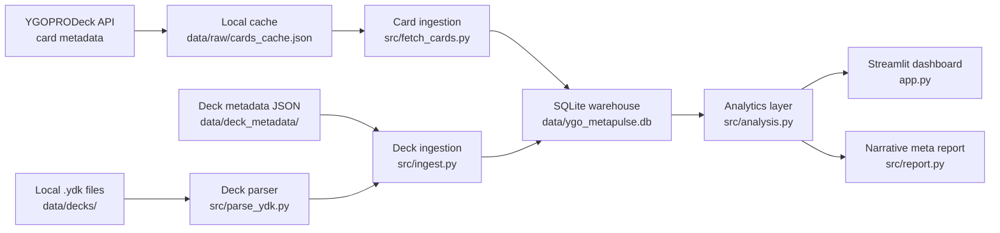

<p align="center">
  
</p>

<h1 align="center">YGO MetaPulse</h1>

<p align="center">
  <strong>End-to-end tournament decklist intelligence for Yu-Gi-Oh! TCG.</strong>
</p>

<p align="center">
  A polished data engineering and analytics portfolio project that ingests decklists, enriches them with card metadata, stores the data in SQLite, and turns competitive trends into an interactive Streamlit dashboard.
</p>

<p align="center">
  
  
  
  
  
  
</p>

## Project Snapshot

YGO MetaPulse takes a familiar hobby dataset and treats it like a real analytics product: raw files are parsed, metadata is cached, records are normalized into a relational database, analytical views are calculated with pandas, and the final insights are presented through a clean dashboard and generated report.

## Portfolio Positioning

YGO MetaPulse is intentionally designed as a GitHub and CV-ready analytics case study rather than a production service. It demonstrates clean ingestion, caching, modeling, testing, and dashboard delivery in a compact repo that runs locally with minimal setup. Sample decklists are included on purpose so reviewers can clone the project and immediately see a working end-to-end flow.

## Why I Built It

I built this to show that data projects do not need to start from perfect corporate datasets to be valuable. The aim was to take a niche, messy, semi-structured source and turn it into something clear, testable, and useful. YGO MetaPulse demonstrates a full data engineering and analytics workflow: API ingestion, local caching, domain-specific parsing, normalized storage, reusable analysis functions, automated tests, and a presentation-ready dashboard.

## Features

- Fetches Yu-Gi-Oh! card metadata from the YGOPRODeck API and caches it locally.
- Parses `.ydk` decklists into structured main, extra, and side deck quantities.
- Stores card, deck, and deck-card relationship data in a normalized SQLite schema.
- Generates a richer illustrative sample dataset automatically so the project works immediately after setup.
- Calculates archetype shares, card usage rates, side-deck trends, engine detection, deck price estimates, and banlist-sensitive usage.
- Produces a polished Streamlit dashboard for exploratory analysis and reporting.
- Includes `pytest` coverage for parsing, database idempotency, and analytics behavior.

## Key Results

- Loads `14,369` cached card metadata rows from YGOPRODeck.
- Ships with `16` illustrative sample decklists spanning `12` archetypes and multiple event dates.
- Produces joined analytics over `300+` unique cards in a reproducible local SQLite workflow.
- Runs locally with a single PowerShell command via [run_project.ps1](./run_project.ps1).

## What This Project Demonstrates

- API ingestion with local caching
- Domain-specific file parsing for `.ydk` decklists
- Relational modeling in SQLite
- Reusable analytics in pandas
- Dashboard-oriented product thinking
- Test coverage for pipeline correctness and idempotency

## Architecture



## Data Pipeline

1. Fetch card metadata from YGOPRODeck.
2. Cache the raw card payload in `data/raw/cards_cache.json`.
3. Parse local `.ydk` files from `data/decks/`.
4. Join each deck with metadata JSON from `data/deck_metadata/`.
5. Store normalized card and deck data in `data/ygo_metapulse.db`.
6. Run analytics with pandas in `src/analysis.py`.
7. Visualize the results in the Streamlit dashboard and generate a readable meta report.

## Repository Layout

```text
ygo-metapulse/
  README.md
  requirements.txt
  pyproject.toml
  app.py
  docs/
    assets/
      ygo-metapulse-logo.png
    screenshots/
      dashboard-overview.png
      card-usage.png
      meta-report.png
  data/
    raw/
      cards_cache.json
    decks/
      sample_maliss_1st.ydk
      sample_orcust_top8.ydk
      sample_blue_eyes_top16.ydk
      sample_sky_striker_top32.ydk
    deck_metadata/
      sample_maliss_1st.json
      sample_orcust_top8.json
      sample_blue_eyes_top16.json
      sample_sky_striker_top32.json
    ygo_metapulse.db
  src/
    __init__.py
    analysis.py
    config.py
    db.py
    fetch_cards.py
    ingest.py
    parse_ydk.py
    report.py
    sample_data.py
  tests/
    test_analysis.py
    test_db.py
    test_parse_ydk.py
```

## Setup

```bash
git clone <your-repo-url>
cd ygo-metapulse
python -m venv .venv
```

Windows PowerShell:

```powershell
.\.venv\Scripts\Activate.ps1
```

macOS / Linux:

```bash
source .venv/bin/activate
```

Install dependencies and run the project:

```bash
pip install -r requirements.txt
python -m src.ingest
streamlit run app.py
```

Windows PowerShell one-command option:

```powershell
.\run_project.ps1
```

If `python` on Windows points to the Microsoft Store placeholder instead of a real interpreter, the PowerShell runner is the easiest option.

## How It Works Locally

- The first ingestion run fetches card metadata from YGOPRODeck and saves a local cache.
- Sample deck metadata is already included in the repo.
- Sample `.ydk` files are generated from cached card data only when no real decklists are present in `data/decks/`.
- Re-running ingestion is safe: deck rows are updated in place and deck-card rows are replaced idempotently.
- If real decklists are present, they automatically take priority over `sample_*` files.

## Dashboard Highlights

- Overview metrics for deck count, card coverage, archetype representation, and estimated deck value
- Archetype share and price-by-archetype visualizations
- Main / extra / side deck usage breakdowns
- Engine detection and banlist watch views
- Deterministic narrative meta report generated from the analytics layer
- Raw data explorer for recruiter-friendly transparency

## Screenshots

Dashboard overview:


Card usage analysis:


Deterministic meta report:


## Example CV Bullet

> Built an end-to-end Yu-Gi-Oh! tournament decklist analytics platform using Python, SQLite, pandas, and Streamlit to ingest decklists, normalize card metadata, calculate meta trends, and generate competitive reports.

## Limitations

- The MVP uses imported decklists instead of live web scraping.
- Trend accuracy improves as more tournament decklists are added.
- Price estimates depend on YGOPRODeck / Cardmarket metadata availability.
- Included sample decks are illustrative demo data rather than tournament-accurate lists.

## Future Improvements

- Upgrade the storage layer to PostgreSQL.
- Add automated tournament deck import workflows.
- Track meta trends over time with a larger historical dataset.
- Add optional LLM-authored narrative report generation.
- Incorporate matchup and win-rate data if reliable sources become available.
- Deploy the dashboard online.
